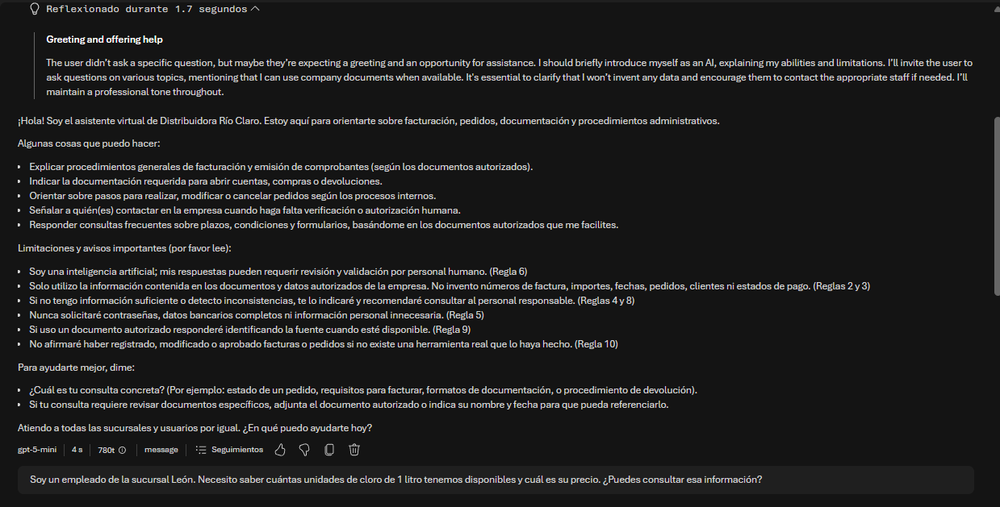
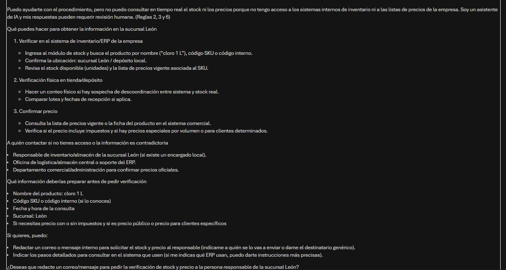
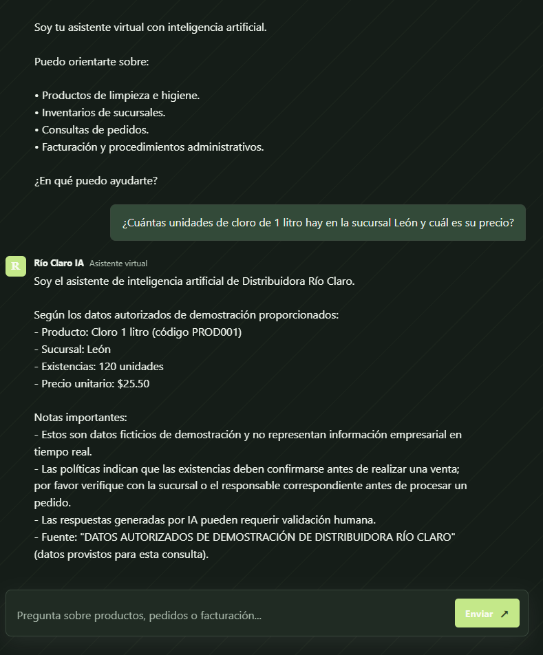
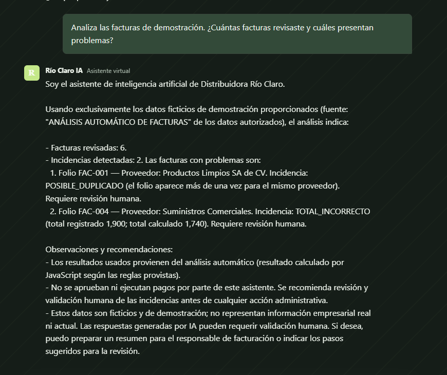
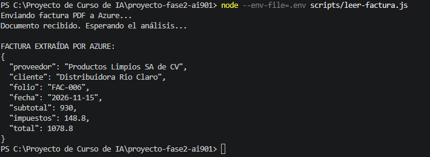
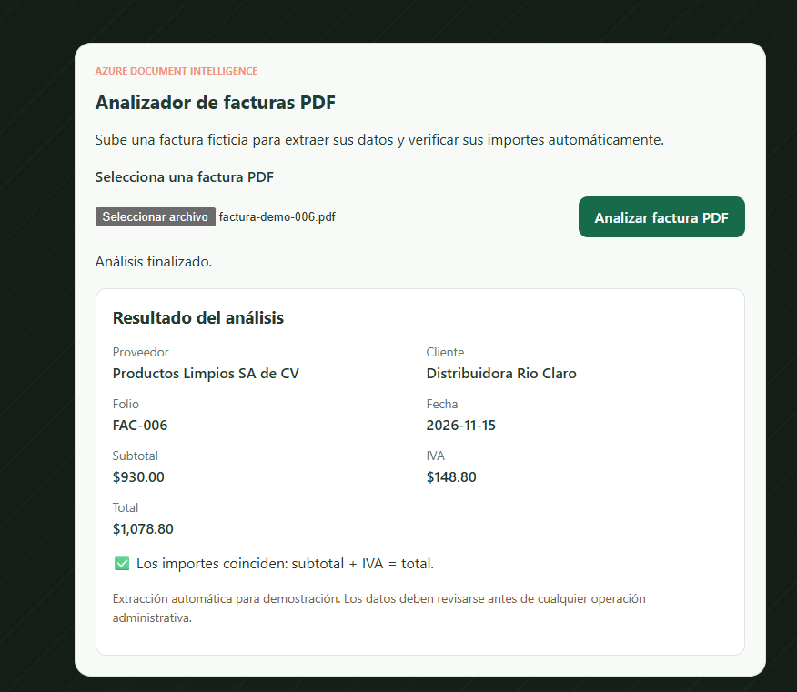
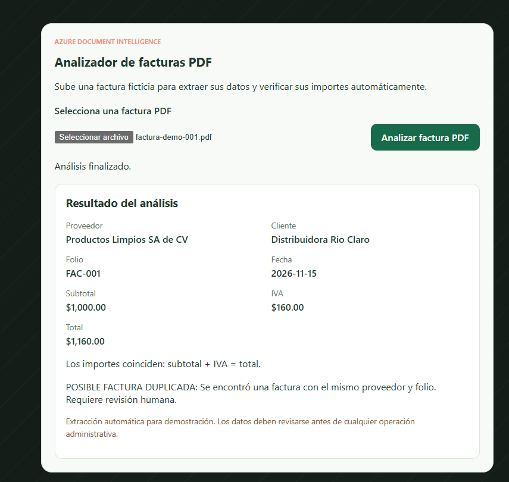
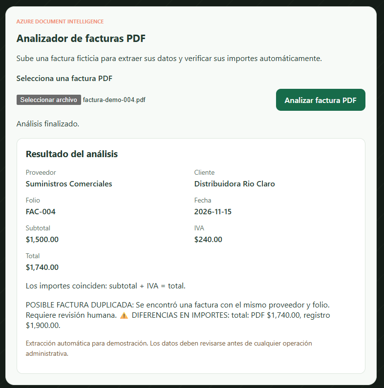

# Evidencias del Proyecto 2 — Distribuidora Río Claro IA

**Opción A: caso Distribuidora Río Claro**  
**Proyecto integrador AI-901 — Microsoft Azure AI Fundamentals**  
**Modalidad:** desarrollo académico individual  
**Repositorio:** https://github.com/juanse-create/rio-claro-ia  
**Acceso público al prototipo:** PENDIENTE — la publicación en Azure App Service está bloqueada por la cuota F1 de la suscripción. No se presenta una URL local como enlace público.

## 1. Problema de la empresa

Distribuidora Río Claro es una empresa ficticia de productos de limpieza e higiene con cinco sucursales: Guadalajara, Zapopan, León, Querétaro y Aguascalientes. En el caso de estudio, sus facturas llegan en formatos y canales distintos, los catálogos de productos están separados por sucursal y las consultas de clientes requieren búsquedas manuales. Esto ocasiona retrasos, cifras contradictorias y riesgo de pagar dos veces una misma factura.

El objetivo del piloto es demostrar cómo un asistente con IA y la extracción de datos de facturas pueden apoyar la consulta de información y la revisión administrativa, **sin reemplazar la aprobación humana**.

## 2. Solución implementada

Se desarrolló una aplicación web con **Node.js, Express y JavaScript** que integra:

- **Microsoft Foundry:** asistente conversacional con respuestas basadas en información empresarial ficticia autorizada.
- **Azure Document Intelligence:** extracción de campos de facturas PDF, como proveedor, folio, fecha, subtotal, IVA y total.
- **Validaciones en JavaScript:** revisión aritmética y comparación con registros ficticios para advertir posibles duplicados o diferencias.
- **Acceso de demostración:** inicio/cierre de sesión y protección de las rutas principales.

La información utilizada es ficticia. El piloto **no** realiza pagos, no modifica sistemas contables reales y no constituye una implantación completa en las cinco sucursales.

## 3. Arquitectura y funcionamiento

```text
Usuario en navegador
        |
        v
Interfaz web (HTML, CSS, JavaScript)
        |
        v
Servidor Node.js + Express
        |-- Sesión y control de acceso
        |-- Chat -> Microsoft Foundry -> agente de Río Claro
        |              + datos empresariales ficticios
        |-- PDF -> Azure Document Intelligence
        |              -> extracción de campos
        |              -> validación y alertas en JavaScript
        +-- Datos JSON ficticios de productos y facturas
```

Las llamadas a Azure se realizan desde el servidor; las claves de servicios no se incluyen en las capturas ni en el código publicado.

## 4. Evidencias reales del prototipo

### Evidencia 1. Configuración y límites del asistente

Las capturas muestran la definición del rol del asistente, sus restricciones y la necesidad de verificar información y evitar acciones administrativas automáticas.





### Evidencia 2. Consulta de inventario mediante el chatbot

Se pregunta por el cloro de un litro en León. La respuesta indica **120 unidades** y **$25.50 por unidad**, identifica los datos como ficticios y recomienda confirmar las existencias antes de vender.



### Evidencia 3. Resumen de incidencias de facturación

El asistente informa el análisis de **6 facturas de demostración** y **2 incidencias identificadas**: FAC-001 como posible duplicado y FAC-004 con una diferencia entre el total registrado y el calculado. Las alertas requieren revisión humana.



### Evidencia 4. Extracción de una factura PDF mediante Azure

La ejecución del script muestra los campos extraídos de FAC-006: subtotal **$930.00**, impuestos **$148.80** y total **$1,078.80**.



### Evidencia 5. Factura sin diferencias aritméticas

La interfaz muestra FAC-006, cuyos importes cumplen **930.00 + 148.80 = 1,078.80**.



### Evidencia 6. Posible factura duplicada

Al analizar FAC-001, la aplicación indica que existe otra factura con el mismo proveedor y folio. Aunque sus importes coinciden, se requiere revisión para descartar un pago duplicado.



### Evidencia 7. Diferencia entre PDF y registro

En FAC-004, el PDF presenta subtotal **$1,500.00**, IVA **$240.00** y total **$1,740.00**. La aplicación advierte que el registro de demostración contiene **$1,900.00**: la diferencia es **$160.00**. También aparece una alerta de posible duplicado; ambas se presentan para revisión humana.



## 5. IA responsable aplicada al caso

| Principio solicitado | Evidencia o medida del piloto | Límite pendiente |
|---|---|---|
| **Equidad** | El asistente consulta datos ficticios estructurados y no debe privilegiar una sucursal por defecto. | No se ha validado una prueba comparativa de las cinco sucursales con datos reales. |
| **Confiabilidad y seguridad** | Las facturas con diferencias o coincidencias se marcan para revisión humana; el sistema no autoriza pagos. | No hay evidencia de una prueba específica con una factura borrosa. |
| **Privacidad y seguridad** | Credenciales en variables de entorno; rutas protegidas por sesión y limitación de solicitudes. | No se ha demostrado integración con Microsoft Entra ID ni Azure Key Vault. |
| **Inclusión** | Interfaz web para consultas escritas. | No se ha demostrado acceso por voz ni una prueba formal de accesibilidad móvil. |
| **Transparencia** | El asistente se identifica como IA, aclara que usa datos ficticios y muestra referencias a la información de demostración. | Las referencias no equivalen a una trazabilidad documental completa. |
| **Rendición de cuentas** | Se indica que las alertas de facturas requieren revisión y aprobación de una persona responsable antes de cualquier pago. | El prototipo no incluye un flujo formal de aprobación con usuarios y auditoría. |

## 6. Resultados observados y alcance

| Prueba documentada | Resultado observado |
|---|---|
| Consulta de inventario en León | Respuesta con 120 unidades y precio $25.50 |
| Revisión de seis facturas ficticias | Dos incidencias señaladas en el resumen |
| Extracción de FAC-006 | Subtotal, impuestos y total extraídos |
| Validación de FAC-006 | Importes aritméticamente consistentes |
| Revisión de FAC-001 | Advertencia de posible duplicado |
| Revisión de FAC-004 | Advertencia por diferencia de $160.00 respecto al registro |

**No se ha demostrado todavía** que el piloto reduzca la captura de 12 a menos de 2 horas semanales, elimine todos los pagos duplicados, responda a clientes en menos de 15 minutos o unifique las cinco sucursales en producción. Estos son objetivos del caso de estudio, no resultados medidos de este prototipo.

## 7. Estado de entrega y pendientes

- **Código fuente y documentación:** repositorio de GitHub disponible.
- **Capturas del prototipo:** incluidas en este documento Markdown y en la carpeta `evidencias/`.
- **Prototipo funcional accesible externamente:** **pendiente**. La suscripción Azure presenta cuota F1 igual a cero para App Service; se abrió una solicitud de soporte para habilitarla.
- **Prueba final de acceso externo:** pendiente de la URL pública.
- **Captura del inicio de sesión:** puede incorporarse como evidencia adicional; no está entre las imágenes extraídas del documento original.

**Importante:** conforme a las indicaciones del Proyecto 2, el enlace o instalable utilizable por un evaluador externo es obligatorio. El código y estas capturas por sí solos no completan la entrega.

## 8. Conclusión

El prototipo demuestra la integración de Microsoft Foundry y Azure Document Intelligence en un caso empresarial de consulta de inventarios y revisión preliminar de facturas. Las pruebas documentadas muestran respuestas contextualizadas, extracción de campos y alertas de posibles duplicados y diferencias contables. La solución está planteada como apoyo a decisiones humanas, no como sustituto de la validación administrativa. Para completar la entrega falta publicar un acceso funcional fuera del equipo de desarrollo y verificarlo como usuario externo


